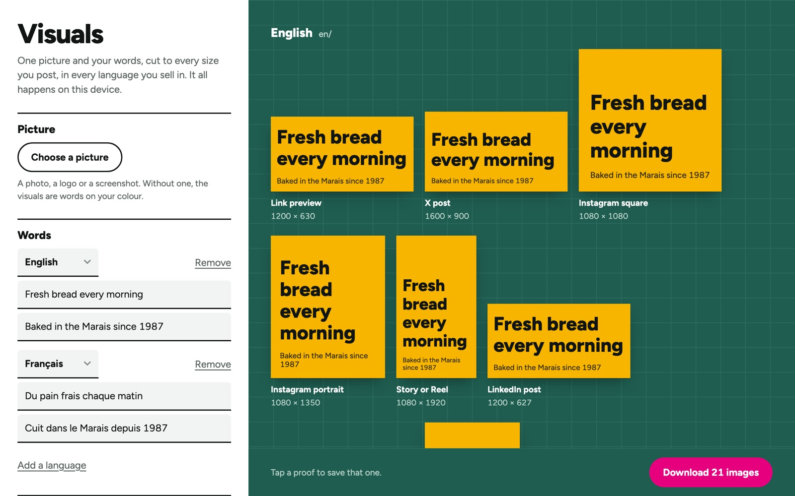

# Visuals, marketing images at every size

> Proof of concept, not a commercial product. This repository is a write-up only; the source code is private.

Live: https://visuals.taskly.business

## Problem

One campaign message has to exist at a dozen sizes (link previews, Instagram, stories, LinkedIn, YouTube, app stores, site icons) and in every language it runs in. Resizing each one by hand is slow, and small mistakes creep in.

## What I built

- One picture plus a headline and a second line per language
- 15 formats drawn at once: 10 social and app store sizes and 5 site icons, for each language
- Three layouts (split, poster, badge) that adapt to wide, square and tall formats, with text that resizes to fit
- Everything downloaded as one zip, sorted by language

## Key decisions

- **Nothing leaves the device.** Images are drawn in the browser, so brand assets are never uploaded anywhere.
- **No machine translation.** Each language's words are typed by a person, because campaign copy needs a human check.
- **One design per layout, not per size.** Each layout reads the shape of the canvas, so adding a new format is one line.

## Stack

JavaScript, HTML canvas, an in-browser zip writer, Cloudflare Pages. No server, no AI, no sign-in.

## Status

Live and free to use. Personal project.

Built with AI-assisted development (Claude Code).
